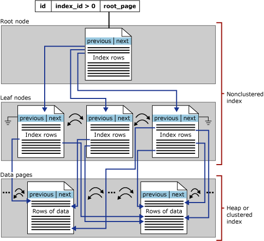
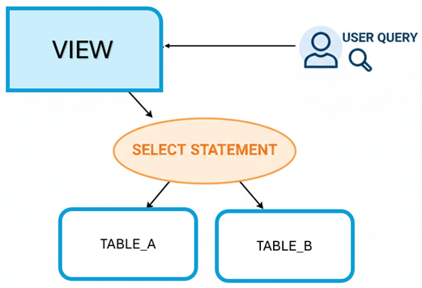
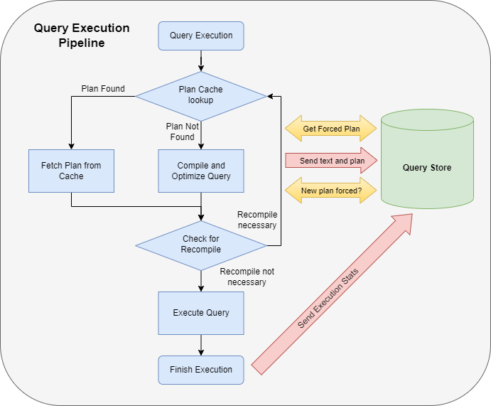
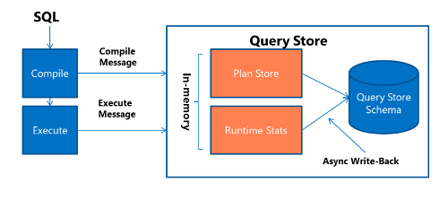

# SQL Server

- [Overview](#overview)
- [Normalization](#normalization)
- [Authentication and Authorization](#authentication-and-authorization)
  - [Concepts](#concepts)
  - [Permissions](#permissions)
  - [Ownership chains](#ownership-chains)
- [Special tables](#special-tables)
  - [System tables](#system-tables)
  - [In-memory tables](#in-memory-tables)
  - [Temporal tables](#temporal-tables)
  - [External tables](#external-tables)
  - [Ledger tables](#ledger-tables)
  - [Graph tables](#graph-tables)
  - [Temporary tables](#temporary-tables)
- [Datatypes](#datatypes)
  - [JSON columns and indexes](#json-columns-and-indexes)
- [Constraints](#constraints)
- [Indexes](#indexes)
  - [Rowstore](#rowstore)
  - [Columnstore](#columnstore)
  - [Other](#other)
- [Partitioning](#partitioning)
- [Programmable objects](#programmable-objects)
  - [Views](#views)
  - [Stored procedures](#stored-procedures)
  - [Scalar functions](#scalar-functions)
  - [Table-valued functions](#table-valued-functions)
  - [Triggers](#triggers)
    - [DML triggers](#dml-triggers)
- [Advanced SQL queries](#advanced-sql-queries)
  - [Common Table Expression (CTE)](#common-table-expression-cte)
  - [Window functions](#window-functions)
  - [JSON functions](#json-functions)
  - [Regex](#regex)
  - [Fuzzy match](#fuzzy-match)
  - [Correlated subqueries](#correlated-subqueries)
  - [`TRY...CATCH...`](#trycatch)
- [Isolation levels](#isolation-levels)
- [Query plans](#query-plans)
  - [Common problems](#common-problems)
- [Query Store](#query-store)
- [Dynamic Management Views (DMV)](#dynamic-management-views-dmv)
- [Performance improvements](#performance-improvements)
  - [Wait statistics](#wait-statistics)
  - [Tune indexes](#tune-indexes)
  - [Resumable index](#resumable-index)
  - [Query hints](#query-hints)
- [Cheatsheets](#cheatsheets)


## Overview

Most content applies to SQL Server only.

Some apply to Azure SQL, as noted.


## Normalization

- **First normal form**
  - A primary key for each table (could be a composite key)
  - No repeating groups (multiple columns for similar data)
- **Second normal form**
  - If a table has a composite key, other attributes must depend on the complete key, not just part of it
- **Third normal form**
  - All nonkey columns are nontransitively dependent on the primary key (a column shouldn't be dependent on another nonkey column)
  - Typically the aim for most OLTP dbs

Considerations:

- A normalized database doesn't always give you the best performance, it requires multiple join operations to get all the necessary data returned in a single query
- Denormalized data can be more efficient, especially for read heavy workloads like a data warehouse. Extra columns offer simpler queries.
  - Data warehouse usually has a star schema or snowflake schema (fact table in the center, which contains mostly numeric values)


## Authentication and Authorization

### Concepts

- **Security principals**:
  - Entities with certain permissions
  - At either server level or database level
    - In `sys.database_principals` table in each DB
  - Type can be a user or a role (a role is like a group)
  - There are several sets in SQL Server, some have fixed membership, some sets have a membership controlled by the SQL Server administrators
- **Securables scopes**:
    - Server
    - Database
    - Schema: you can assign permissions to a role at this level
- **Schema**
  - A schema is like a folder inside a database that holds tables, views, etc.
  - Helps with organization, permissions, and naming separation
  - Each principal (user and role) has a default schema (if no, then it's `dbo`)
    - `dbo` stands for "database owner"
  - If you don't specify schema, like `SELECT name FROM customers`, it checks the user default schema, then `dbo`
  - Best practices is to always specify a schema
- **Logins**
  - At server instance level
  - Credentials stored in the `master` db
  - Should be linked to by user accounts in one or more DBs
  - Logins are for authentication, the mapped users are for authorization in each DB
  ```sql
  USE [master]
  GO

  -- create login in master db
  CREATE LOGIN demo WITH PASSWORD = 'Pa55.w.rd'
  GO

  USE [MyDBName]
  GO

  -- create a linked user in another db
  CREATE USER demo FROM LOGIN demo
  GO
  ```
- **Contained users**
  - Database level
  - Not linked to a login
  - Could be SQL auth or Windows/Entra auth
  - DB must be configured for partial containment (default in Azure SQL DB, optional in SQL Server)
  ```sql
  -- in a user db context
  CREATE USER [dba@contoso.com] FROM EXTERNAL PROVIDER;
  GO
  ```
- **Roles**
  - Effective security groups
  - Custom roles can be created at the server or db level
    - Server roles can't be granted access to db object directly
    - Server roles NOT available in Azure SQL DB
    - Schema scoped permissions can be granted to a role
      ```sql
      CREATE USER [DP300User1] WITH PASSWORD = 'Pa55.w.rd'
      GO
      CREATE ROLE [SalesReader]
      GO
      ALTER ROLE [SalesReader] ADD MEMBER [DP300User1]
      GO
      GRANT SELECT, EXECUTE ON SCHEMA::Sales TO [SalesReader]
      GO
      ```
  - Application roles
    - There's a preconfigured password
    - User activate the role with the password, then the role permissions are applied to the user, until the role is deactivated
  - Built-in db roles (for each db)
    - All configured with `db_`
    - eg. `db_owner`, `db_datareader`, `db_accessadmin` (can create new users), `db_securityadmin` (can grant permissions)
    - `db_denydatawriter`: prevent from writing data, when users have been granted rights via other roles or directly
    - All users within a db are automatically members of the `public` role, which has no permissions
    - `db_owner` users can always see all data in a db, applications can use `Always Encrypted` to protect data from privileged users
    - Azure SQL DB nuances
      - `master` db is virtual
        - DB roles only available in `master` db: `loginmanager`, `dbmanager`
      - Sever admin has `sysadmin` rights, you can create more limited admins
  - Fixed server-level roles
    - Can be assigned to server-level principals (SQL Server logins, Windows accounts, Windows groups)
    - Permissions are fixed, except the `public` role
    - eg. `sysadmin`, `serveradmin`, `securityadmin`, `dbcreator`, `public` etc
    - Azure SQL DB:
      - Fixed server-level roles
        - `##MS_DatabaseConnector##`
        - `##MS_DatabaseManager##`
        - `##MS_DefinitionReader##`
        - `##MS_LoginManager##`
        - `##MS_SecurityDefinitionReader##`
        - `##MS_ServerStateReader##`
        - `##MS_ServerStateManager##`
      - Only server-level logins can be members: `ALTER SERVER ROLE ...`
      - To propagate to a db, the login need a mapped user account in the db
      - Each member of a fixed server role can add other logins to that same role


### Permissions

- Four basic operation permissions: `SELECT`, `INSERT`, `UPDATE`, and `DELETE`
  - Other table/view permissions: `CONTROL`, `REFERENCES`, `TAKE OWNERSHIP`, `VIEW CHANGE TRACKING`, `VIEW DEFINITION`
  - Function/stored procedure permissions: `ALTER`, `CONTROL`, `EXECUTE`, `VIEW CHANGE TRACKING`, `VIEW DEFINITION`
- Perimssions can be granted, revoked, or denied
  - On tables and views
  - `DENY` supersedes over `GRANT`
  - Can additionally restrict the columns
  - SQL Server and Azure SQL DB also include row-level security
- You can use `EXECUTE AS USER = <user_name>` to change user context

### Ownership chains

- When a funcion or stored procedure executes, it inherits the permissions of the owner.
- Example:
  - The owner of `SP_DEMO` has access to `SELECT` on `[Sales].[Orders]`
  - User `user001` does not have access to `[Sales].[Orders]`, but can `EXECUTE` `SP_DEMO`
  - Then `user001` can't execute `SELECT` on the table, but can run the stored procedure
- Dynamic SQL in a stored procedure is executed outside the context of the calling procedure, DON'T inherit permissions of the procedure owner. The calling user's permissions apply.


## Special tables

### System tables

- `sys.database_principals` contains both `SQL_USER` and `DATABASE_ROLE`, each has a principal_id
  - users: `dbo`, `guest`, `sys`, ...
  - roles: `db_owner`, `db_accessadmin`, `db_datareader`, ...
- `sys.database_role_members` contains members of each role, eg. `dbo` is a member of `db_owner`
- Query users of each role
  ```sql
  -- Query users in a particular role
  SELECT dp.name, dp.type_desc, dprole.name
  FROM
      sys.database_role_members drm
  JOIN
      sys.database_principals dp ON drm.member_principal_id = dp.principal_id
  JOIN
      sys.database_principals dprole ON drm.role_principal_id = dprole.principal_id
  ```

### In-memory tables

- For high-frequency, low latency scenarios
- Transaction logs still writes to disks
- Don't support large objects like `VARCHAR(MAX)`, etc
- Create with `MEMORY_OPTIMIZED = ON` option

Examples:
- Web session state
- Financial trading
- Shopping cart
- As a caching layer (product catalogs, configurations)
- Staging tables (in ETL processes)

### Temporal tables

- Track complete history of data changes
- Create with `SYSTEM_VERSIONING = ON` option, requires two extra `DATETIME2` to track the validity period of each row version
- SQL Server automatically creates a history table to store previous row versions
- Examples:
  - Tracking salary changes and promotions
  - Inventory analyzing
  - Patient record history
  - Insurance tracking policy coverage changes

### External tables

- Querying data across data lakes, blob storage, and multiple systems.
- Scenarios:
  - Data lake integration - query Parquet/CSV files in ADLS
  - Archival storage - access historical data stored in cheaper blob storage
- Limitations:
  - Slower
  - Read-only
  - Limited indexing and optimization

```sql
-- Create external table pointing to data lake
CREATE EXTERNAL TABLE dbo.ExternalSalesData (
    OrderID INT,
    CustomerID INT,
    OrderAmount DECIMAL(10,2),
    OrderDate DATE
) WITH (
    LOCATION = '/raw/sales/',
    DATA_SOURCE = DataLakeSource,
    FILE_FORMAT = ParquetFormat
);
```

### Ledger tables

- Use blockchain technology to create tamper-evident records
- Two types:
  - Updatable (allows `INSERT`, `UPDATE` and `DELETE`)
  - Append-only (allows only `INSERT`)
- A table could be both updatable ledger table and temporal table
- Create with `LEDGER=ON` option, `APPEND_ONLY=ON` for append-only
- Verify data integrity using built-in system views like `sys.database_ledger_transactions`
- Use `sp_verify_database_ledger` to validate the cryptographic chain remains unbroken

### Graph tables

- Two types of tables:
  - Node tables, has an auto-generated `$node_id` column
  - Edge tables, has auto-genraged `$edge_id`, `$from_id`, `$to_id` columns
- Uses the `MATCH` syntax for querying
- Example

```sql
-- Create graph tables
CREATE TABLE Person AS NODE;
CREATE TABLE Manages AS EDGE;
CREATE TABLE Knows AS EDGE;

-- Insert nodes
INSERT INTO Person VALUES (1, 'Alice'), (2, 'Bob'), (3, 'Charlie');

-- Insert edges (relationships)
INSERT INTO Manages VALUES (1, 2), (2, 3);

-- Query relationships
SELECT Person1.name, Person2.name
FROM Person AS Person1, Manages, Person AS Person2
WHERE MATCH(Person1-(Manages)->Person2)
AND Person1.id = 1;
```

Edge table can have other properties

```sql
INSERT INTO dbo.ReportsTo ($from_id, $to_id, StartDate, ReportType)
SELECT
    (SELECT $node_id FROM dbo.Person WHERE Name = 'Alice Johnson'),
    (SELECT $node_id FROM dbo.Person WHERE Name = 'Bob Smith'),
    '2023-01-15',
    'Direct';
```

Arrow direction matters:

- `(Node1)-(Edge)->(Node2)`: Edge goes from Node1 to Node2
- `(Node1)<-(Edge)-(Node2)`: Edge goes from Node2 to Node1

A single `MATCH` can chain multiple relationships

```sql
-- one alias can only be used once in a MATCH, so create multiple aliases here
...
FROM dbo.Person AS p1,
     dbo.Knows AS k,
     dbo.Person AS p2,
     dbo.Purchased AS pu,
     dbo.Product AS prod
WHERE MATCH(p1-(k)->p2-(pu)->prod)
```

`SHORTEST_PATH`, use `FOR PATH` to mark all node and edge tables in variable-length matching

```sql
-- finds all people reachable from Alice within three hops and counts the distance to each
SELECT
    StartPerson.Name,
    LAST_VALUE(ReachablePerson.Name) WITHIN GROUP (GRAPH PATH) AS ReachablePerson,
    COUNT(ReachablePerson.Name) WITHIN GROUP (GRAPH PATH) AS Distance
FROM dbo.Person AS StartPerson,
     dbo.Knows FOR PATH AS k,
     dbo.Person FOR PATH AS ReachablePerson
WHERE MATCH(SHORTEST_PATH(StartPerson(-(k)->ReachablePerson){1,3}))
  AND StartPerson.Name = 'Alice Johnson';
```


### Temporary tables

- Temporary table name starts with `#`, can be created using `SELECT INTO` or normal `CREATE TABLE`
- They exists in system database `tempdb`
- Temporary tables are only accessible within the session that created them
- To make a temporary table accessible across connections, prefix table name with `##`

  ```sql
  USE TestDB
  SELECT * INTO #mytemptable FROM Inventory WHERE id = 1;
  GO

  SELECT * FROM #mytemptable
  ```


## Datatypes

Some common datatypes:

| Datatype           | Size (bytes)    | Description                                                     |
| ------------------ | --------------- | --------------------------------------------------------------- |
| `char`             | 1 per character | Fixed-length non-Unicode text, e.g., `char(2)` for country code |
| `varchar`          | 1 per character | Variable-length non-Unicode text                                |
| `nvarchar`         | 2 per character | Unicode text                                                    |
| `int`              | 4               | Integer                                                         |
| `bigint`           | 8               | Large integer, e.g., `Population BIGINT`                        |
| `decimal`          | Varies          | Financial data, e.g., `Revenue DECIMAL(8,2)`                    |
| `date`             | 3               | Date only, no time                                              |
| `datetime2`        | 6-8             | Provides better precision than `datetime`                       |
| `uniqueidentifier` | 16              | GUIDs                                                           |

### JSON columns and indexes

- Introduced SQL Server 2025 as a native data type
  - For earlier versions, you could use an `NVARCHAR(MAX)` column
- Stored in binary format
- You can create a computed column based on a JSON property, then create an index on it
- Use `CHECK` constraints with `JSON_PATH_EXISTS` to ensure required fields are present, eg. `CHECK (JSON_PATH_EXISTS(AdditionalAttributes, '$.weight') = 1),`
- Usage scenarios:
  - User preference settings
  - Flexible metadata (eg. product with variable attributes, tags, labels)
  - Multi-tenant applications

Example:

```sql
-- Create table with native JSON type (SQL Server 2025+)
CREATE TABLE ConfigurationData (
    ConfigID INT PRIMARY KEY,
    ConfigSettings JSON NOT NULL
);

-- Insert JSON documents
INSERT INTO ConfigurationData (ConfigID, ConfigSettings)
VALUES (1, '{"theme":"dark","language":"en","notifications":true}');

INSERT INTO ConfigurationData (ConfigID, ConfigSettings)
VALUES (2, '{"theme":"light","language":"fr","notifications":false}');

-- Query JSON properties
SELECT ConfigID,
       JSON_VALUE(ConfigSettings, '$.theme') AS Theme,
       JSON_VALUE(ConfigSettings, '$.language') AS Language,
       JSON_QUERY(ConfigSettings, '$') AS FullConfig
FROM ConfigurationData;

-- Update a single property using the modify method (SQL Server 2025+ preview)
UPDATE ConfigurationData
SET ConfigSettings.modify('$.theme', 'light')
WHERE ConfigID = 1;

-- Alternative: JSON_MODIFY works with both JSON and NVARCHAR(MAX) columns
UPDATE ConfigurationData
SET ConfigSettings = JSON_MODIFY(CAST(ConfigSettings AS NVARCHAR(MAX)), '$.notifications', CAST(0 AS BIT))
WHERE ConfigID = 1;

-- Create a computed column on a property, then add an index
ALTER TABLE ConfigurationData
ADD ThemeValue AS JSON_VALUE(ConfigSettings, '$.theme');

CREATE INDEX IX_Theme ON ConfigurationData(ThemeValue);
```


## Constraints

- `PRIMARY KEY`
  - Don't allow `NULL`
  - A unique index (prefixed `PK_`) created automatically
- `FOREIGN KEY`
  - Syntax `FOREIGN KEY (CustomerID) REFERENCES Customer(CustomerID)`
  - Could be added on the `PRIMARY KEY` column
  - Use `CASCADE`, `SET NULL`, or `SET DEFAULT` to specify what happens (in the foreign key table) when a user tries to delete or update a key to which existing foreign keys point
- `UNIQUE`
  - Allows one `NULL` value in the column
  - A unique nonclustered index (prefixed `UQ_`) is created automatically
- `CHECK`
  - Example: `CHECK (Salary >= 20000), CHECK (HireDate <= GETDATE())`
  - `NULL` is still allowed
- `DEFAULT`
  - You can define a constraint name
  - Example: `CreatedDate DATETIME2 CONSTRAINT DF_Activity_CreatedDate DEFAULT GETUTCDATE()`
- `IDENTITY`
  - Automatic numbering for a single table
- `SEQUENCE`
  - Could be used by multiple tables or multiple columns within a table
  - You can get a range
  - Value could be cycled, doesn't enforce uniqueness
  - Example:
    ```sql
    -- Create sequence
    CREATE SEQUENCE OrderNumber
        START WITH 1000
        INCREMENT BY 1
        MINVALUE 1000
        MAXVALUE 999999
        NO CYCLE;

    -- Use sequence in INSERT with NEXT VALUE FOR function
    INSERT INTO Order (OrderID, CustomerID, OrderNumber, OrderDate)
    VALUES (1, 100, NEXT VALUE FOR OrderNumber, GETDATE());

    -- Get next value before INSERT
    DECLARE @NextOrderNum INT = NEXT VALUE FOR OrderNumber;
    SELECT @NextOrderNum;

    -- Get multiple sequence numbers at once for batch processing
    DECLARE @FirstSeq INT, @LastSeq INT;
    EXEC sp_sequence_get_range
        @sequence_name = N'OrderNumber',
        @range_size = 100,
        @range_first_value = @FirstSeq OUTPUT,
        @range_last_value = @LastSeq OUTPUT;

    -- Reset sequence
    ALTER SEQUENCE OrderNumber RESTART WITH 1000;
    ```


## Indexes

### Rowstore

- **Clustered index**
  - Is the underlying table, defines how the rows are sorted and stored
  - A table can have ONLY ONE clustered index
    - A table without a clustered index is called a *heap*, typically used only as staging tables
  - Clustered index key should:
    - As narrow as possible
    - Use columns with unique and distinct values
    - On columns used frequently for sorting
    - Usually include the primary key (but NOT mandatory)
  - Primary key will be clustered by default, if you don't specify another clustered key
  - eg. for an `Orders` table, primary key is `OrderId`, clustered index on `OrderDate`
- **Nonclustered indexes**
  - Separate structures from the data rows
  - Can have multiple nonclustered indexes on a table
  - Contains the key values, each key value entry has a pointer to the data row that contains the key value
  - Always contains the clustered key
  - Can add extra nonkey columns to the leaf level of an index
    - If a nonclustered index doesn't have all the columns to fulfill a query, then a "**Key lookup**" against the clustered index operation happens in an execution plan

Example:

  ```sql
  -- Create clustered index on primary key (defines physical row order)
  CREATE CLUSTERED INDEX IX_Product_ProductID
  ON Product(ProductID);

  -- Create non-clustered index on frequently searched column
  CREATE NONCLUSTERED INDEX IX_Product_Category
  ON Product(Category)
  INCLUDE (ProductName, Price);
  ```

|           | Clustered                                                           | Non-clustered                                   |
| --------- | ------------------------------------------------------------------- | ----------------------------------------------- |
| Per table | One                                                                 | Multiple                                        |
| Best for  | Efficient range queries, stable and narrow keys, natural sort order | Specific predicates, joins, or sorting patterns |


### Columnstore

- Intially targeted at data warehouses
  - Best on analytic queries scanning large data sets, such as fact tables
- Enhance performance for queries involving large aggregation
- Store each column independently
  - Reduced IO by scanning necessary columns
  - Greater compression due to similar data within a column
- Batch execution mode: `SELECT SUM(Sales) FROM SalesAmount;`
- Suitable for:
  - Data warehouse fact tables
  - Reporting databases
  - Historical data
- NOT for:
  - Small tables (< 1M rows) (rowgroups need sufficient rows for effective compression)
  - High-frequency updates/deletes
  - Single-row lookup
- Architecture:
  - Organizes data into rowgroups (up to 1M rows)
  - Within each rowgroup, each column is stored (and compressed) independently as *column segment*
  - Inserting:
    - Small batches go to a *deltastore* (a temporary rowstore structure using a B+ tree index), once accumulates to 102,400 rows, a background process `tuple-mover` compresses it into the columnstore
    - Bulk loads (> 102,400) bypass the deltastore, go directly to columnstore
- Fragmentation: Modifications mark rows as *deleted* rather than updating in place, causing fragmentation

Types:

- **Clustered (CCI)**
  - Represents the table itself, stored in a special way
  - Include all columns, but NOT sorted
  - Use this when analytics is the primary workload
- **Nonclustered (NCCI)**
  - Stored independently
  - Can be added to a rowstore clustered table, so a table could be used for both transactional and analytic workloads

Examples:

```sql
-- Create clustered columnstore index (replaces clustered rowstore)
CREATE CLUSTERED COLUMNSTORE INDEX CCI_SalesHistory
ON SalesHistory;

-- Rebuild to improve compression
ALTER INDEX CCI_SalesHistory ON SalesHistory REBUILD;

-- Create non-clustered columnstore for analytics
CREATE NONCLUSTERED COLUMNSTORE INDEX NCCI_Product_Analytics
ON Product(Price, StockQuantity, Category, ProductName);
```

You can get the health of columnstore indexes with `sys.dm_db_column_store_row_group_physical_stats`

```sql
-- Check columnstore health
SELECT
    object_name(object_id) AS TableName,
    state_desc,
    total_rows,
    deleted_rows,
    size_in_bytes / 1024 / 1024 AS SizeMB
FROM sys.dm_db_column_store_row_group_physical_stats
WHERE object_id = OBJECT_ID('SalesHistory');
```
- State:
  - Open: accepting inserts in the deltastore
  - Closed: waiting for `tuple-mover` to compress them
  - Compressed: already in columnar format
- High deleted row counts or many small rowgroups indicate fragmentation, use `ALTER INDEX REORGANIZE` to resolve


### Other

B-tree structure:



Considerations:

- Read benefits from indexes more
- Optimize indexes for most frequently run queries
- Choose appropriate data types
- Use *filtered index* in large tables on columns with low-cardinality values (like a bit flag)
- Create indexes on views, if the view contains aggregations and/or joins


## Partitioning

Divides large tables into smaller, more manageable partitions, while keeping then as a single logical table. A typical example: an "Orders" table partitioned by `Orderdate` value

- Concepts:
  - Partition function: how data is divided
  - Partition scheme: maps partition to filegroups
- Partition key
  - Should be included in most queries
  - Partition key must be included in primary key
  - Data should be distributed evenly across partitions
  - Target millions of rows per partion, not thousands
  - Schedule jobs to add new partitions, or archive old ones
- Indexes could be aligned or nonaligned with the partition scheme
  - By default, nonclustered indexes inherit the table's partition scheme

Example:

```sql
-- Create partition function based on date ranges
-- Use RANGE RIGHT for datetime columns to keep same-day values together
CREATE PARTITION FUNCTION PF_OrderDate (DATETIME2)
    AS RANGE RIGHT FOR VALUES
    ('2024-01-01', '2024-04-01', '2024-07-01', '2024-10-01');

-- Create partition scheme mapping to a single filegroup (recommended)
-- Use multiple filegroups only for tiered storage or independent backups
CREATE PARTITION SCHEME PS_OrderDate
    AS PARTITION PF_OrderDate ALL TO ([PRIMARY]);

-- Create partitioned table
-- Include partition column in primary key for clustered index alignment
CREATE TABLE Orders (
    OrderID INT NOT NULL,
    OrderDate DATETIME2 NOT NULL,
    CustomerID INT,
    Amount DECIMAL(10,2),
    CONSTRAINT PK_Orders PRIMARY KEY (OrderID, OrderDate)
) ON PS_OrderDate(OrderDate);
```

Query partition info, use (`$PARTITION` function):

```sql
-- View partition information
SELECT
    $PARTITION.PF_OrderDate(OrderDate) AS PartitionNumber,
    MIN(OrderDate) AS MinDate,
    MAX(OrderDate) AS MaxDate,
    COUNT(*) AS RowCount
FROM Orders
GROUP BY $PARTITION.PF_OrderDate(OrderDate)
ORDER BY PartitionNumber;
```

Add new partition boundary

```sql
-- Split partition to add new boundary
ALTER PARTITION FUNCTION PF_OrderDate()
    SPLIT RANGE ('2024-11-01');
```

Archive or merge partition

```sql
-- Merge partitions to archive old data
ALTER PARTITION FUNCTION PF_OrderDate()
    MERGE RANGE ('2023-12-31');
```


## Programmable objects

### Views



- A virtual table
  - Based on a `SELECT` statement
  - Encapsulate reusable query logic
  - You CAN `INSERT` and `UPDATE` data through a view (use `WITH CHECK OPTION` to make sure only rows visible in the view could be inserted/updated)
- Also a security boundary, you can grant user access to views without giving out full table access
- Views could be nested, you should keep them shallow
- Use other objects in these scenarios:
  - Indexed views (materialized views): result stored physically, for performance-critical queries that always return the same result
  - UDF: for complex calculations that accept parameters
  - Stored procedure: for data modification logic

Example:

```sql
CREATE VIEW Sales.OrderSummary
AS
SELECT
    OrderID,
    CustomerID,
    OrderDate,
    TotalAmount,
    -- can have computed columns
    CASE
        WHEN TotalAmount < 100 THEN 'Small'
        WHEN TotalAmount < 1000 THEN 'Medium'
        ELSE 'Large'
    END AS OrderSize
FROM Sales.Orders;

CREATE VIEW Sales.HighValueOrders
AS
SELECT
    OrderID,
    CustomerID,
    OrderDate,
    TotalAmount
FROM Sales.Orders
WHERE TotalAmount > 1000
WITH CHECK OPTION; -- use this to ensure only insert/update rows with TotalAmount > 1000
```

### Stored procedures

- Precompiled and optimized
- To encapsulate complex business logic, enforce data validation rules
- Example usage:
  - validate input
  - apply business rules
  - log change before modifying dat
- Best practices
  - Use schema qualified names, eg. `dbo.UpdateCustomerAddress`
    - DON'T use the `sp_` prefix, SQL Server reserves this prefix for system procedures in the `master` database
  - Validate parameters at the start of your procedure
  - Avoid `SELECT *`

```sql
-- With parameters
CREATE PROCEDURE dbo.GetCustomerOrdersByDate
    @CustomerID int,
    @StartDate datetime = NULL,
    @EndDate datetime = NULL
AS
BEGIN
    SET NOCOUNT ON; -- don't return how many rows affected

    SELECT
        OrderID,
        OrderDate,
        TotalAmount
    FROM dbo.Orders
    WHERE CustomerID = @CustomerID
        AND (@StartDate IS NULL OR OrderDate >= @StartDate)
        AND (@EndDate IS NULL OR OrderDate <= @EndDate)
    ORDER BY OrderDate DESC;
END

-- can have an output parameter
CREATE PROCEDURE dbo.CalculateOrderTotal
    @OrderID int,
    @TotalAmount decimal(10,2) OUTPUT
AS
BEGIN
    SET NOCOUNT ON;

    SELECT @TotalAmount = SUM(Quantity * UnitPrice)
    FROM dbo.OrderDetails
    WHERE OrderID = @OrderID;

    RETURN 0;
END

-- with TRY...CATCH
CREATE PROCEDURE dbo.InsertCustomerOrder
    @CustomerID int,
    @OrderDate datetime,
    @TotalAmount decimal(10,2)
AS
BEGIN
    SET NOCOUNT ON;

    BEGIN TRY
        BEGIN TRANSACTION;

        -- Validate customer exists
        IF NOT EXISTS (SELECT 1 FROM dbo.Customers WHERE CustomerID = @CustomerID)
        BEGIN
            RAISERROR('Customer does not exist.', 16, 1);
        END

        -- Insert order
        INSERT INTO dbo.Orders (CustomerID, OrderDate, TotalAmount)
        VALUES (@CustomerID, @OrderDate, @TotalAmount);

        COMMIT TRANSACTION;
        RETURN 0;
    END TRY
    BEGIN CATCH
        IF @@TRANCOUNT > 0 -- ROLLBACK if necessary
            ROLLBACK TRANSACTION;

        DECLARE @ErrorMessage nvarchar(4000) = ERROR_MESSAGE();
        DECLARE @ErrorSeverity int = ERROR_SEVERITY();
        DECLARE @ErrorState int = ERROR_STATE();

        RAISERROR(@ErrorMessage, @ErrorSeverity, @ErrorState);
        RETURN -1;
    END CATCH
END
```

### Scalar functions

- Returns a single value
- Can be used in `SELECT`, `  WHERE`, and other T-SQL expressions
- Management
  - You can modify a defined function with `ALTER FUNCTION`
  - Before `ALTER FUNCTION`, check if other objects depend on it by checking `sys.sql_expression_dependencies`
- Deterministic function
  - Always return same result with same input
  - A function that reference system date/time functions (eg. `GETDate()`) or tables are non-deterministic
  - Non-deterministic functions can't be used in indexed views or indexed on computed columns
- Best practices
  - Keep it deterministic when possible
  - Avoid side effects (eg. modify data)
  - Avoid using it in `WHERE` on large tables (the function executes for every row, degrading performance)

Example:

```sql
CREATE FUNCTION dbo.CalculateSalesTax
(
    @Amount DECIMAL(10,2),
    @TaxRate DECIMAL(5,4)
)
RETURNS DECIMAL(10,2)
AS
BEGIN
    DECLARE @TaxAmount DECIMAL(10,2)
    SET @TaxAmount = @Amount * @TaxRate
    RETURN @TaxAmount
END
```

### Table-valued functions

- Return result sets, like tables or views
- Could be used in `FROM` or `JOIN`
- Two types
  - Inline
    - A single `SELECT` statement
    - Like views with parameters
    - Better performance than multi-statement TVF
    - Allows plan caching because the optimizer expands them directly in the query plan
  - Multi-statement
    - Uses a `BEGIN...END` block
    - Explicitly declares the structure of the returned table

Inline TVF

```sql
CREATE FUNCTION dbo.GetCustomerOrders
(
    @CustomerID INT
)
RETURNS TABLE
AS
RETURN
(
    SELECT
        OrderID,
        OrderDate,
        TotalAmount,
        Status
    FROM Sales.Orders
    WHERE CustomerID = @CustomerID
);

-- use it like a table
SELECT OrderID, OrderDate, TotalAmount
FROM dbo.GetCustomerOrders(1001)
WHERE OrderDate >= '2024-01-01';
```

Multi-statement TVF

```sql
CREATE FUNCTION dbo.GetProductSalesSummary
(
    @StartDate DATE,
    @EndDate DATE
)
RETURNS @SalesSummary TABLE
(
    ProductID INT,
    ProductName NVARCHAR(100),
    TotalQuantity INT,
    TotalRevenue DECIMAL(18,2),
    AveragePrice DECIMAL(18,2)
)
AS
BEGIN
    INSERT INTO @SalesSummary
    SELECT
        p.ProductID,
        p.ProductName,
        SUM(od.Quantity) AS TotalQuantity,
        SUM(od.Quantity * od.UnitPrice) AS TotalRevenue,
        AVG(od.UnitPrice) AS AveragePrice
    FROM Production.Products p
    INNER JOIN Sales.OrderDetails od ON p.ProductID = od.ProductID
    INNER JOIN Sales.Orders o ON od.OrderID = o.OrderID
    WHERE o.OrderDate BETWEEN @StartDate AND @EndDate
    GROUP BY p.ProductID, p.ProductName;

    RETURN;
END;
```

Use TVF in ``JOIN`

```sql
SELECT
    c.CustomerName,
    o.OrderID,
    o.TotalAmount
FROM Customers c
CROSS APPLY dbo.GetCustomerOrders(c.CustomerID) o
WHERE o.Status = 'Completed';
```

### Triggers

- Special stored procedures
- Responds to DML or DDL operations
- Best practices:
  - Keep them efficient to minimize impact
  - Keep logic focused and minimal (eg. log to another table, and process them later)
  - Avoid recursive operations
  - Handle errors properly (if you don't handle an error in a trigger, the transcation rolls back)
  - Document them

#### DML triggers

Two types
  - `AFTER` triggers: to validate changes, update related tables, logging, etc
  - `INSTEAD OF` triggers: to modify views, or to implement complex logic
- You could access pseudo-tables `inserted` or `deleted`
  - For `UPDATE`, `inserted` contains new values, `deleted` holds old values
- A single trigger could responds to multiple events by combining `INSERT`, `UPDATE`, and `DELETE` in the trigger definition

```sql
CREATE TRIGGER tr_UpdateInventory
ON Sales.OrderDetails
AFTER INSERT
AS
BEGIN
    UPDATE Inventory.Products
    SET QuantityInStock = QuantityInStock - i.Quantity
    FROM Inventory.Products p
    INNER JOIN inserted i ON p.ProductID = i.ProductID;
END;

CREATE TRIGGER tr_UpdateOrderView
ON Sales.OrderSummaryView
INSTEAD OF UPDATE
AS
BEGIN
    UPDATE Sales.Orders
    SET OrderStatus = i.OrderStatus,
        ModifiedDate = GETDATE()
    FROM Sales.Orders o
    INNER JOIN inserted i ON o.OrderID = i.OrderID;
END;
```

Multiple DML operations:

```sql
CREATE TRIGGER tr_AuditEmployeeChanges
ON HR.Employees
AFTER INSERT, UPDATE, DELETE
AS
BEGIN
    DECLARE @Operation NVARCHAR(10);

    IF EXISTS (SELECT * FROM inserted) AND NOT EXISTS (SELECT * FROM deleted)
        SET @Operation = 'INSERT';
    ELSE IF EXISTS (SELECT * FROM inserted) AND EXISTS (SELECT * FROM deleted)
        SET @Operation = 'UPDATE';
    ELSE
        SET @Operation = 'DELETE';

    INSERT INTO Audit.EmployeeLog (EmployeeID, Operation, ChangeDate)
    SELECT COALESCE(i.EmployeeID, d.EmployeeID), @Operation, GETDATE()
    FROM inserted i
    FULL OUTER JOIN deleted d ON i.EmployeeID = d.EmployeeID;
END;
```

## Advanced SQL queries

### Common Table Expression (CTE)

- Use the `WITH` clause, can be referenced multiple times in a query
- Could define multiple CTEs, later ones can reference earlier ones
  ```sql
  WITH CategorySales AS
  (
      SELECT
          p.ProductCategoryID,
          SUM(sod.LineTotal) AS CategoryRevenue
      FROM SalesLT.Product AS p
      INNER JOIN SalesLT.SalesOrderDetail AS sod
          ON p.ProductID = sod.ProductID
      GROUP BY p.ProductCategoryID
  ),
  RankedCategories AS
  (
      SELECT
          ProductCategoryID,
          CategoryRevenue,
          RANK() OVER (ORDER BY CategoryRevenue DESC) AS RevenueRank
      FROM CategorySales
  )
  SELECT
      pc.Name AS CategoryName,
      rc.CategoryRevenue,
      rc.RevenueRank
  FROM RankedCategories AS rc
  INNER JOIN SalesLT.ProductCategory AS pc
      ON rc.ProductCategoryID = pc.ProductCategoryID
  WHERE rc.RevenueRank <= 5;
  ```
- Could be recursive, enabling hierarchical data travesal, recursive level default to 100, could be customized with `OPTION (MAXRECURSION n)`
  ```sql
  WITH EmployeeHierarchy AS
  (
      -- Anchor: Start with top-level managers (no manager)
      SELECT
          EmployeeID,
          FirstName,
          LastName,
          ManagerID,
          0 AS Level,
          CAST(FirstName + ' ' + LastName AS NVARCHAR(500)) AS HierarchyPath
      FROM HumanResources.Employee
      WHERE ManagerID IS NULL

      UNION ALL

      -- Recursive: Find employees who report to previously found employees
      SELECT
          e.EmployeeID,
          e.FirstName,
          e.LastName,
          e.ManagerID,
          eh.Level + 1,
          CAST(eh.HierarchyPath + ' > ' + e.FirstName + ' ' + e.LastName AS NVARCHAR(500))
      FROM HumanResources.Employee AS e
      INNER JOIN EmployeeHierarchy AS eh
          ON e.ManagerID = eh.EmployeeID
  )
  SELECT
      EmployeeID,
      FirstName,
      LastName,
      Level,
      HierarchyPath
  FROM EmployeeHierarchy
  ORDER BY HierarchyPath;
  ```
  - Recursive CTEs could be used for generating number or date ranges
    ```sql
    -- Generate a numbers table from 1 to 1000
    WITH Numbers AS
    (
        -- Anchor: Start with 1
        SELECT 1 AS n
        UNION ALL
        -- Recursive: Increment until we reach 1000
        SELECT n + 1 FROM Numbers WHERE n < 1000
    ),
    -- Convert numbers to dates for the entire year
    DateRange AS
    (
        SELECT DATEADD(DAY, n - 1, '2024-01-01') AS OrderDate
        FROM Numbers
        WHERE DATEADD(DAY, n - 1, '2024-01-01') <= '2024-12-31'
    )
    -- Count orders for each date, showing 0 for dates with no orders
    ```

### Window functions

Performing calculations across a set of rows related to current row (eg. ranking), while preserving all original rows in the result.

```sql
function_name(arguments) OVER (
    [PARTITION BY partition_expression] -- divide rows into groups
    [ORDER BY order_expression [ASC | DESC]] -- order within each partition
    [ROWS | RANGE frame_specification]
)
```

Ranking

```sql
-- ROW_NUMBER(), a unique sequential number for each row
-- results are ordered by the `ORDER BY` in the window function !
SELECT
    ProductID,
    Name,
    ListPrice,
    ROW_NUMBER() OVER (ORDER BY ListPrice DESC) AS PriceRank
FROM SalesLT.Product
WHERE ListPrice > 0;

-- RANK(), skips numbers for ties, eg. three "1", then "4", etc
-- DENSE_RANK(), eg. three "1", then "2", number not skipped
-- NTILE(n), divides rows into percentiles, groups are roughly the same size
```

With `PARTITION BY`, to get per-group ranking

```sql
SELECT
    pc.Name AS Category,
    p.Name AS Product,
    p.ListPrice,
    ROW_NUMBER() OVER (
        PARTITION BY p.ProductCategoryID
        ORDER BY p.ListPrice DESC
    ) AS CategoryPriceRank
FROM SalesLT.Product AS p
INNER JOIN SalesLT.ProductCategory AS pc
    ON p.ProductCategoryID = pc.ProductCategoryID
WHERE p.ListPrice > 0;
```

Use standard aggregate functions like `SUM`, `AVG`, `COUNT`, `MIN` and `MAX` as windows functions by adding the `OVER` clause. This can be used to get cumulative aggregates.

```sql
SELECT
    SalesOrderID,
    OrderDate,
    TotalDue,
    -- use "ORDER BY" to get cumulative aggregation from partion start to current row, otherwise it's calculated across the entire partition
    SUM(TotalDue) OVER (ORDER BY OrderDate, SalesOrderID) AS RunningTotal,
    AVG(TotalDue) OVER (ORDER BY OrderDate, SalesOrderID) AS RunningAverage,
    COUNT(*) OVER (ORDER BY OrderDate, SalesOrderID) AS OrderNumber
FROM SalesLT.SalesOrderHeader
ORDER BY OrderDate, SalesOrderID;
```

Window frames with `ROWS` and `RANGE`
- `UNBOUNDED PRECEDING`: From the partition start
- `n PRECEDING`: n rows before current row
- `CURRENT ROW`: The current row
- `n FOLLOWING`: n rows after current row
- `UNBOUNDED FOLLOWING`: To the partition end

```sql
SELECT
    SalesOrderID,
    OrderDate,
    TotalDue,
    AVG(TotalDue) OVER (
        ORDER BY OrderDate
        ROWS BETWEEN 2 PRECEDING AND CURRENT ROW
    ) AS MovingAvg3Orders
FROM SalesLT.SalesOrderHeader
ORDER BY OrderDate;
```

Analytical functions
- `LAG(colName, n, defaultValue)`: n rows preceding current row
- `LEAD(colName, n, defaultValue)`: n rows after current row
- `FIRSTVALUE(colName)`: first value in a frame
- `LASTVALUE(colName)`: last value in a frame, use `ROWS BETWEEN UNBOUNDED PRECEDING AND UNBOUNDED FOLLOWING`, otherwise it returns current row
- `PERCENT_RANK()` relative position within a partition (0 to 1), don't include itself
- `CUME_DIST()` including itself

### JSON functions

- `JSON_VALUE()` extract a scalar value
- `JSON_QUERY()` extract an object or array
- `OPENJSON(@jsonName) WITH (...)` to turn JSON to rowset

  ```sql
  DECLARE @json NVARCHAR(MAX) = N'{
      "customer": {
          "id": 12345,
          "name": "Contoso Ltd",
          "active": true
      },
      "orderTotal": 1599.99
  }';

  SELECT
      JSON_QUERY(@json, '$.customer') AS CustomerObject,
      JSON_VALUE(@json, '$.customer.id') AS CustomerID,
      JSON_VALUE(@json, '$.customer.name') AS CustomerName,
      JSON_VALUE(@json, '$.orderTotal') AS OrderTotal;
  ```

- `JSON_OBJECT()` and `JSON_ARRAY()` for building JSON

  ```sql
  SELECT JSON_OBJECT(
      'orderId': soh.SalesOrderID,
      'orderDate': soh.OrderDate,
      'customer': JSON_OBJECT(
          'id': c.CustomerID,
          'name': c.CompanyName
      ),
      'totals': JSON_OBJECT(
          'subtotal': soh.SubTotal,
          'tax': soh.TaxAmt,
          'total': soh.TotalDue
      )
  ) AS OrderJson
  FROM SalesLT.SalesOrderHeader AS soh
  INNER JOIN SalesLT.Customer AS c
      ON soh.CustomerID = c.CustomerID
  WHERE soh.SalesOrderID = 71774;
  ```

- `JSON_ARRAYAGG()` for aggregating data into arrays, combining with `GROUP BY ...`
- `ISJSON()` to validate JSON format, `NULL` returns `NULL`
- `JSON_PATH_EXISTS()`

- Path modes:
  - `lax $.path.to.key` return `NULL` if path not found
  - `strict $.path.to.key` raise an error if path not found

- Computed column for JSON properties

  ```sql
  -- Add a computed column that extracts a JSON property
  -- This computed column is virtual, calculated at query time
  ALTER TABLE Products
  ADD ProductCategory AS JSON_VALUE(ProductData, '$.category');

  -- The column is now available in queries
  SELECT ProductID, ProductName, ProductCategory
  FROM Products
  WHERE ProductCategory = 'Electronics';
  ```

- You can also persist a computed column and add index (could be multiple columns and a composite index)

  ```sql
  -- Extract multiple properties
  ALTER TABLE Products
  ADD ProductCategory AS JSON_VALUE(ProductData, '$.category') PERSISTED,
      ProductBrand AS JSON_VALUE(ProductData, '$.brand') PERSISTED,
      ProductPrice AS CAST(JSON_VALUE(ProductData, '$.price') AS DECIMAL(10,2)) PERSISTED;

  -- Create a composite index for common query patterns
  CREATE INDEX IX_Products_Category_Brand ON Products(ProductCategory, ProductBrand);

  -- Create an index for price range queries
  CREATE INDEX IX_Products_Price ON Products(ProductPrice);
  ```

- Use `FOR JSON PATH` and aliases to transform rowset output as JSON

  ```sql
  SELECT
      p.ProductID AS 'product.id',
      p.Name AS 'product.name',
      pc.Name AS 'product.category'
  FROM SalesLT.Product AS p
  INNER JOIN SalesLT.ProductCategory AS pc
      ON p.ProductCategoryID = pc.ProductCategoryID
  WHERE p.ProductID = 680
  FOR JSON PATH;
  ```

  Result is like `[{"product":{"id":680,"name":"HL Road Frame - Black, 58","category":"Road Frames"}}]`

### Regex

Same syntax as ECMAScript

- `REGEXP_LIKE` check pattern exist or not
- `REGEXP_REPLACE` check pattern exist or not
- `REGEXP_SUBSTR` extract subsring
- `REGEXP_INSTR` starting position of a pattern
- `REGEXP_COUNT` pattern occurrence count
- `REGEXP_SPLIT_TO_TABLE` table-valued function (TVF), split a string to rows, a `value` column, eg. `REGEXP_SPLIT_TO_TABLE(@data, '[,;|]')`
- `REGEXP_MATCHES` table-valued function (TVF), returns two columns `match_value`, `match_id`

### Fuzzy match

- `EDIT_DISTANCE`
  - How many single-character edits away from one string to another
- `EDIT_DISTANCE_SIMILARITY`
  - Between 0 to 100 (identical)
  - Better for longer strings
- `JARO_WINKLER_DISTANCE`
  - For phonetic similarity
  - Designed for comparing names and short strings
  - Higher scores to strings that match from the beginning
  - Score above 0.9 indicates a strong match for names

Note:
- You should narrow results first before applying expensive fuzzy functions
  - Use `LIKE` patterns, exact matches, or range filters, etc

### Correlated subqueries

Correlated subquery:
  - a subquery that reference columns from the outer query
  - the subquery execute once for each row processed by the outer query

Compares each row agains a dynamically calculated value based on that row's attributes

Usage scenarios:
  - Identify outliers in a group
  - Find top-N per group

Notes:
  - Query optimizer often transforms correlated subqueries into equivalent joins internally.
    - Use `SET STATISTICS IO ON` to examine the actual execution plan
  - Should use window functions for some scenarios
    - To find max value per group, `ROW_NUMBER()` is better than `MAX()` in subquery

```sql
-- Correlated subquery (executes per outer row)
-- Find products with higher than average price in each category
SELECT p1.ProductID, p1.Name, p1.ListPrice
FROM SalesLT.Product AS p1
WHERE p1.ListPrice > (
    SELECT AVG(p2.ListPrice)
    FROM SalesLT.Product AS p2
    WHERE p2.ProductCategoryID = p1.ProductCategoryID  -- References outer query
);
```

`EXISTS`
- Typically outperforms `IN` with subqueries, the optimizer can stop after finding the first match
- Example
  ```sql
  -- Find customers who have placed at least one order
  SELECT CustomerID, FirstName, LastName
  FROM SalesLT.Customer AS c
  WHERE EXISTS (
      SELECT 1
      FROM SalesLT.SalesOrderHeader AS soh
      WHERE soh.CustomerID = c.CustomerID
  );
  ```

Find top-N rows in a group

```sql
-- can also be done with window function
SELECT
    pc.Name AS Category,
    p.Name AS Product,
    p.ListPrice
FROM SalesLT.Product AS p
INNER JOIN SalesLT.ProductCategory AS pc
    ON p.ProductCategoryID = pc.ProductCategoryID
WHERE p.ProductID IN (
    SELECT TOP 3 p2.ProductID
    FROM SalesLT.Product AS p2
    WHERE p2.ProductCategoryID = p.ProductCategoryID
    ORDER BY p2.ListPrice DESC
)
ORDER BY pc.Name, p.ListPrice DESC;
```

### `TRY...CATCH...`

```sql
BEGIN TRY
    -- Attempt an operation that might fail
    INSERT INTO SalesLT.Customer (CustomerID, FirstName, LastName)
    VALUES (1, 'Test', 'Customer');  -- Duplicate key causes error
END TRY
BEGIN CATCH
    -- Log error details to a table using the ERROR_* functions
    INSERT INTO ErrorLog (
        ErrorTime,
        ErrorNumber,
        ErrorSeverity,
        ErrorState,
        ErrorProcedure,
        ErrorLine,
        ErrorMessage
    )
    VALUES (
        GETDATE(),
        ERROR_NUMBER(),       -- The error number (e.g., 2627 for duplicate key)
        ERROR_SEVERITY(),     -- Severity level (0-25)
        ERROR_STATE(),        -- Error state for debugging
        ISNULL(ERROR_PROCEDURE(), 'Ad hoc query'),  -- NULL if not in a procedure
        ERROR_LINE(),         -- Line number where error occurred
        ERROR_MESSAGE()       -- Full error message text
    );

    -- Re-raise the error to the calling application
    THROW;
END CATCH;
```

Roll back transactions:
- `SET XACT_ABORT ON;` to automatically rolls back transactions, could be used together with `TRY...CATCH`

```sql
SET XACT_ABORT ON;

BEGIN TRY
    -- Start a transaction to group multiple operations
    BEGIN TRANSACTION;

    -- First operation: update product prices
    UPDATE SalesLT.Product
    SET ListPrice = ListPrice * 1.05
    WHERE ProductCategoryID = 5;

    -- Second operation: update order totals
    -- If this fails, we want to undo the first update too
    UPDATE SalesLT.SalesOrderHeader
    SET TotalDue = TotalDue * 1.05
    WHERE CustomerID = 12345;

    -- Both operations succeeded, make changes permanent
    COMMIT TRANSACTION;
END TRY
BEGIN CATCH
    -- Check if a transaction is still active before rolling back
    -- Some errors auto-rollback before reaching `CATCH`, so @@TRANCOUNT might be 0
    IF @@TRANCOUNT > 0
        ROLLBACK TRANSACTION;  -- Undo all changes from this transaction

    -- Re-raise the error so the caller knows something failed
    THROW;
END CATCH;
```

`THROW` and `RAISERROR`
- `THROW` is recommended, it includes a stack trace
- `RAISERROR` when you need formatted message, or compatibility requirement

```sql
-- User defined error number must > 50000, state parameter between 1 and 255
THROW 50002, 'Order not found.', 1;

-- RAISERROR provide more printf style formatting
DECLARE @ProductName NVARCHAR(100) = 'Widget Pro';
DECLARE @CurrentStock INT = 5;
DECLARE @RequestedQty INT = 10;

IF @CurrentStock < @RequestedQty
BEGIN
    RAISERROR(
        'Insufficient stock for product "%s". Available: %d, Requested: %d',
        16,  -- Severity
        1,   -- State
        @ProductName,
        @CurrentStock,
        @RequestedQty
    );
END;
```

## Isolation levels

- It's a **session level** setting, there's NO global isolation level
- Use a proper level to balance consistency and concurrency
- Locks could be on different levels:
  - Row
  - Table (if more than 5000 rows need to be locked, escalate to the table level)
  - DB
- "autocommit" is the default, or explicitly use `BEGIN TRANSACTION` and `COMMIT TRANSACTION`

Levels:

- Read uncommitted
  - Max concurrency
  - Read uncommitted data from another transcation
- Read committed (default level)
  - Shared lock released after read
  - If a row is read multiple times in the same transaction, it might get different data (updated by other transactions)
- Repeatable Read
  - Holds "shared lock" on a row, preventing updates
  - Phantom rows: another transaction could still insert a new row with the same ID
- Serializable
  - Holds a "key-range" lock, preventing inserts into the key range
  - Lowest concurrency
- With row-versioning
  - To turn on SNAPSHOT for a DB: `ALTER DATABASE MyDb SET ALLOW_SNAPSHOT_ISOLATION ON`
  - Levels
    - Read Committed Snapshot (RCSI)
      - RCSI is the default, no need to set in the session
      - Transaction always see last committed version at the time when transaction began
      - If the transaction read again, it may get a newly committed value
    - Snapshot
      - Need to be set explicitly in a session: `SET TRANSACTION ISOLATION LEVEL SNAPSHOT`
      - Like RCSI, reader gets old committed data, not blocked
      - Different from RCSI, this gets a static snapshot, used through out the transaction (like "Repeatable Read")

Troubleshooting:

- Use `sys.dm_tran_locks`, joined with `sys.dm_exec_requests`, to find locks held by each session
- Or use Extended Events
  ```sql
  USE MASTER
  GO

  CREATE EVENT SESSION [MySession] ON SERVER
    ADD EVENT sqlserver.blocked_process_report (
      ACTION (...)
    )
    ...
  GO

  ALTER EVENT SESSION [MySession] ON SERVER
    STATE = start;
  GO
  ```


## Query plans

Query processing steps:

1. Check syntax, generate a parse tree of db objects
1. Parse tree -> *Algebrizer* for bindings -> processor tree
    1. Validates columns and object exists, identifies data types
1. Generates *query_hash*, check if a cache exists in the plan cache
    - Different explicit parameter values could cause a different plan
    - If you use a parameter in your query, `OPTION (RECOMPILE)` causes the query compiler to replace the parameter with its value
2. If no cache, *query optimizer* generates several execution plans
3. Plan executed -> results

Query optimizer

- Cost based
- Factors considered when calculating cost:
  - Statistics on the columns
  - Potential indexes
- Complex queries can have thousands of possible execution plans
- Optimizer doesn't evaluate every single one

Three types of plans:

- Estimated plan
  - `SET SHOWPLAN_ALL ON`
  - Query not executed
  - Saved in plan cache
- Actual plan
  - `SET STATISTICS PROFILE ON`
  - Includes runtime statistics
- Live Query Statistics
  - Animated execution progress

### Common problems

- Hardware constraints
- Suboptimal query constructs
- SARGability
  - Able to use *SEEK* operation on index, instead of scanning the entire index or table
  - Wildcard on the left: `LIKE %word`, make the query non-SARGable
- Missing indexes
  - recommendations in `sys.dm_db_missing_index_details`
- Missing and out-of-date statistics
- Poor optimizer choices
- Parameter sniffing
  - When there's data skew, query performance could vary widely
  - Possible solution: Use hint `OPTION (RECOMPILE)` to force query recompile


## Query Store

Three stores:

- Plan store
- Runtime stats store
- Wait stats store

Need to enable in SQL Server:

```sql
ALTER DATABASE <database_name> SET QUERY_STORE = ON (OPERATION_MODE = READ_WRITE);
```

*Enabled by default in Azure SQL DB*



Built-in views:

- Regressed Queries
- Overall Resource Consumption
- Top Resource Consumption Queries
- Queries with Forced Plans
- Queries with High Variation
- Query Wait Statistics
- Tracked Queries

Automatic plan correction:

- `sys.dm_db_tuning_recommendations`: recommendations about query plan regressions
  - If Query Store is enabled, recommendations are always enabled
- Optionally enable `AUTOMATIC_TUNING`
  - Enabled by default for Azure SQL DB



Query Store data are written to disk asynchronously

Init size: 100MB, max: 2GB ?


## Dynamic Management Views (DMV)

- There are DMVs and DMFs, most people use the acronym DMV for both
- Hundreds of objects
- Contain system information, to monitor the health of a server instance, diagnose problems, and tune performance
- All prefixed with `sys.dm_*`
- Three categories:
  - db-related
  - query execution related
  - transaction related

Two levels:

- **Server scoped objects** – require `VIEW SERVER STATE` permission on the server
- **Database scoped objects** – require the `VIEW DATABASE STATE` permission within the database

Examples:

- Execution & Query stats (Performance)
  - `sys.dm_exec_query_stats` - query exec time, CPU, reads, ect, contains `sql_handle` and `plan_handle`
  - `sys.dm_exec_query_plan(plan_handle)` - *a DMF*, exec plan XML
  - `sys.dm_exec_query_plan_stats` - Seems same as above ?
  - `sys.dm_exec_sql_text(sql_handle)` - get the text of a SQL batch for a specific sql handle
  - ...
  - `sys.dm_exec_sessions` - user and system sessions (running or sleeping)
  - `sys.dm_exec_requests` - details about each request currently executing, identify long running
  - ...
- Index & stats
  - `sys.dm_db_index_usage_stats` - How often indexes are read/updated
  - `sys.dm_db_missing_index_details` - Missing index suggestions
  - `sys.dm_db_index_physical_stats()` - Fragmentation, page count
  - `sys.dm_db_stats_properties` - Histogram + stats details
- Waits
  - `sys.dm_os_wait_stats` - aggregated data since last restart
  - `sys.dm_os_waiting_tasks` - current waiting tasks
  - `sys.dm_exec_requests` - active queries (including wait type/time as well)
- Locking & Blocking
  - `sys.dm_tran_locks` - current locks, including `session_id`
  - `sys.dm_os_waiting_tasks` - current waiting tasks, including `blocking_session_id`
  - `sys.dm_exec_sessions / requests` - identify blockers
- Memory & caching
  - `sys.dm_os_sys_memory` - OS memory info
  - `sys.dm_exec_cached_plans` - cached plan, size and use counts etc
- I/O & Storage
  - `sys.dm_io_virtual_file_stats()` - I/O stats for database files
  - `sys.dm_db_file_space_usage` - db file space usage
- Resource usage
  - `sys.resource_stats` - in `master`, historical CPU/storage usage data for an Azure SQL Database, has db name and start_time
  - `sys.server_resource_stats` (Azure SQL MI)
  - `sys.dm_db_resource_stats` - (SQL DB) for each DB, one row every 15 seconds, only data for last hour
  - ...
  - `sys.dm_user_db_resource_governance` (Azure SQL DB)
  - `sys.dm_instance_resource_governance` (Azure SQL MI)
- Misc
  - `sys.dm_pdw_nodes_*` - for Azure Synapse Analytics and Analytics Platform System (PDW)


## Performance improvements

### Wait statistics

Three types:

- **Resource waits**
  - Locks, latches, disk I/O
- **Queue waits**
  - a thread waiting for work to be assigned
  - Examples: deadlock monitoring, deleted record cleanup
- **External waits**
  - Examples: getting results from linked server query, return results to client

Stats:

- `sys.dm_exec_session_wait_stats`: active waiting sessions
- `sys.dm_os_wait_stats` wait history (`sys.dm_db_wait_stats` Azure for SQL DB)
- Query Store also tracks some waits data (not as granular as DMV)

Common waits:

- `RESOURCE_SEMAPHORE`: wait on memory, could indicate long query runtimes (out-of-date stats, missing indexes), or high query concurrency
- `SOS_SCHEDULER_YIELD`: high CPU utilization, suggesting high number of large scans, missing indexes
- `CXPACKET`: improper config or high CPU utilization. To resolve, lower MAXDOP, and increase the cost threshold for parallelism
- `LCK_M_X`: *a lock*, Blocking problem. Could be resolved by changing to `READ COMMITTED SNAPSHOT` isolation level, optimizing indexes, improving transaction management within T-SQL code
- `PAGEIOLATCH_SH`: *a latch*, query scans excessive amounts of data, indicating bad indexes. If `waiting_tasks_count` is low, but `wait_time_ms` is high, it suggests storage performance problems
- `PAGEIOLATCH_UP`: *a latch*, TempDB contention on Page Free Space (PFS) data pages. Best practice: use one file per CPU core for TempDB, the files should have the same size and outgrowth settings

### Tune indexes

- Update operations that do lookups can benefit from extra indexes or columns added to an existing index
- Evaluate existing index usage using `sys.dm_db_index_operational_stats` and `sys.dm_db_index_usage_stats`
- Eliminate unused and duplicate indexes
  - For monthly/quarterly/yearly operations, create indexes just before the operations
- Review and evaluate expensive queries from Query Store, Extended Events capture, manually craft indexes to better serve those
- Test in nonprod environment first
- In an index, columns should be ordered according to selectivity

### Resumable index

You can pause and then restart index building process

```sql
-- Creates a nonclustered index for the Customer table
CREATE INDEX IX_Customer_PersonID_ModifiedDate
    ON Sales.Customer (PersonID, StoreID, TerritoryID, AccountNumber, ModifiedDate)
WITH (RESUMABLE=ON, ONLINE=ON)
GO

ALTER INDEX IX_Customer_PersonID_ModifiedDate ON Sales.Customer PAUSE
GO
```

### Query hints

Examples:

- `FAST <int>`: retrieve first <int> number of rows while continueing query execution
- `OPTIMIZE FOR`
- `USE PLAN` - use a plan specified by the `xml_plan` attribute
- `RECOMPILE` - create a new, temporary plan for the query, and discards it immediately after the query is executed
- `{ LOOP | MERGE | HASH } JOIN` - specifies method for all join operations in the query
- `MAXDOP <int>` - overrides `sp_configure`, also Resource Governor

Notes:

If you can't modify query text, you can set hints for a query in Query Store:

`EXEC sys.sp_query_store_set_hints @query_id= 42, @query_hints = N'OPTION(RECOMPILE, MAXDOP 1)'`


## Cheatsheets

- Run with Docker

  ```sh
  docker run \
    -e "ACCEPT_EULA=Y" \
    -e "SA_PASSWORD=myPassword" \
    -p 1433:1433 \
    --name sql1 \
    -h sql1 \
    -d mcr.microsoft.com/mssql/server:2019-latest
  ```

  Connect to SQL Server

  ```sh
  docker exec -it sql1 "bash"

  # run in the container
  /opt/mssql-tools/bin/sqlcmd -S localhost -U SA -P "myPassword"
  ```

- Create a database and a table

  ```sql
  CREATE DATABASE TestDB
  SELECT Name from sys.Databases
  GO  --need this to actually run queries above

  USE TestDB
  CREATE TABLE Inventory (id INT, name NVARCHAR(50), quantity INT)
  INSERT INTO Inventory VALUES (1, 'banana', 150), (2, 'orange', 154);
  GO

  SELECT * FROM Inventory WHERE quantity > 152;
  GO
  ```

- A join query

  ```sql
  SELECT p.ProductID, p.Name AS ProductName,
          c.Name AS Category, p.ListPrice
  FROM SalesLT.Product AS p
  JOIN [SalesLT].[ProductCategory] AS c
      ON p.ProductCategoryID = c.ProductCategoryID;
  ```

- Show client name and IP

  ```sql
  SELECT  hostname,
          net_library,
          net_address,
          client_net_address
  FROM    sys.sysprocesses AS S
  INNER JOIN    sys.dm_exec_connections AS decc ON S.spid = decc.session_id

  -- hostname      net_library    net_address     client_net_address
  -- vm-demo       TCP/IP         FCAC0BDC7F1C    10.0.0.8
  -- GARY-WIN10    TCP/IP         87C81F2C585D    218.101.119.105


  -- for current client only
  SELECT  hostname,
        net_library,
        net_address,
        client_net_address
  FROM    sys.sysprocesses AS S
  INNER JOIN    sys.dm_exec_connections AS decc ON S.spid = decc.session_id
  where spid = @@SPID
  ```


- Loop through a list of tables/dbs to get some stats

  ```sql
  -- get all table names
  DROP TABLE IF EXISTS #tablenames
  CREATE TABLE #tablenames (name NVARCHAR(50));
  INSERT INTO #tablenames VALUES ('Table1'), ('Table2')

  -- create a stats table
  DROP TABLE IF EXISTS #tablestats
  CREATE TABLE #tablestats (
    name NVARCHAR(50),
    mycount INT,
  );

  DECLARE @tblname VARCHAR(50)
  DECLARE @sql NVARCHAR(300)
  -- use a cursor for looping
  DECLARE db_cursor CURSOR FOR
    SELECT name FROM #tablenames

  OPEN db_cursor
    FETCH NEXT FROM db_cursor INTO @tblname -- get value into a variable
    WHILE @@FETCH_STATUS = 0
      BEGIN
          PRINT @tblname

          SET @sql = 'INSERT INTO #tablestats VALUES (''' + @tblname + ''', (SELECT COUNT(id) FROM TestDB.dbo.' + @tblname + ')  )'
          EXEC(@sql)

          FETCH NEXT FROM db_cursor INTO @tblname
      END
  CLOSE db_cursor
  DEALLOCATE db_cursor

  SELECT * FROM #tablestats
  ```
